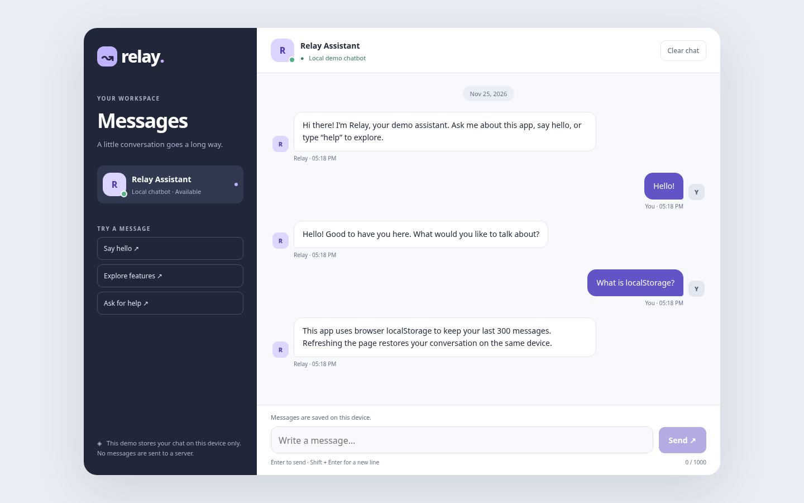

# Relay — Real-Time Chat Interface

Responsive frontend-only chat with instant messages, timestamps, predefined chatbot replies and persistent history.

[Mobile preview](docs/mobile-preview.png)

## Features

- Chat composer with Send button, Enter to send and Shift+Enter for a new line.
- Instant sent messages and distinct received bubbles.
- Local rule-based chatbot with a simulated typing delay and predefined replies.
- Timestamps and date separators; smooth scrolling and CSS message animations.
- localStorage stores the last 300 messages and pending replies; history restores on refresh.
- Empty input protection, 1000-character limit, clear-history confirmation and storage error handling.
- Responsive design and keyboard navigation. No real multi-user messaging, network connection or AI backend.

## Implementation

`script.js` creates message nodes using `document.createElement` and `appendChild`, renders untrusted text with `textContent`, and uses `setTimeout` for chatbot replies.

## Run locally

Extract the ZIP, open this project folder in VS Code, and use **Open with Live Server** on `index.html`. Alternatively, with Python installed, run `python -m http.server 8000` from this folder and open `http://localhost:8000`. The project can also be opened as a static HTML page, but browser storage on `file://` URLs varies; localhost or HTTPS is recommended. No backend is required.

## GitHub upload

See [UPLOAD-GUIDE.md](UPLOAD-GUIDE.md) for the complete GitHub Desktop procedure. Use a separate public repository named `chat-interface` if the evaluator requires public access. A public GitHub repository is sufficient if the assignment asks only for source code; enable GitHub Pages only if a live demo is required or desired.

## Files

- `index.html` — semantic markup
- `style.css` — responsive layout, design and animations
- `script.js` — application functionality
- `docs/` — screenshots from browser tests
- `tests/browser_test.py` — optional automated tests
- `UPLOAD-GUIDE.md` — submission instructions

## Testing

JavaScript syntax and Chromium functional integration tests passed, including horizontal-overflow checks at 320, 390, 768, 1024 and 1440 pixels. In the restricted authoring environment direct URL navigation was blocked. The tests therefore loaded the actual markup, styles and scripts into Chromium with an in-memory storage adapter for refresh tests; the studio test also resolves local SVGs as embedded data URLs. Native localStorage behavior under a real URL and GitHub Pages deployment were not independently verified. The application itself uses standard browser APIs and relative local assets.

Optional: install Python Playwright (`pip install playwright`), then `playwright install chromium` and run `python tests/browser_test.py` from the project folder. Tests use a temporary localhost server by default. Set environment variable `OFFLINE_TEST=1` to run the restricted-environment harness instead. Set `CHROMIUM_PATH` to use an existing Chromium executable. The tests regenerate preview screenshots.
